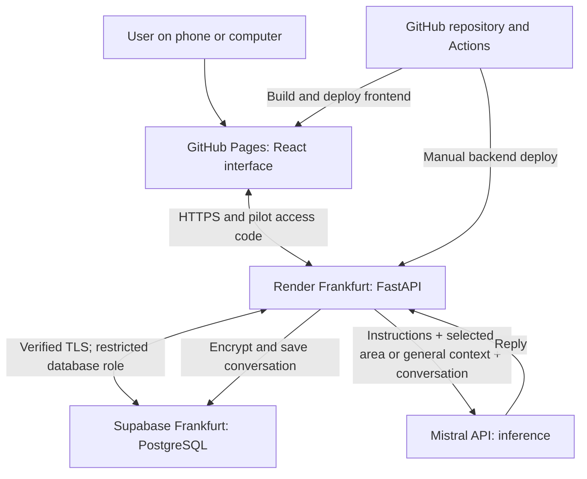

# Personal assistant strategy — 16 November 2026

## Product decision

Personalization belongs in the user's editable memory and permissions, not a separately fine-tuned model per person. Start with one coordinator, scoped context, and deterministic tools. Domain specialists can initially be separate instructions and tool permissions using the same model; they do not need to be autonomous agents talking to each other.

The first useful loop is: connect or enter a source → select facts → review memory → ask for help → review an action → receive a recorded result. Never treat an imported email, profile, job description, or training note as an instruction to the system.

## Current deployed structure

Live: private pilot access, areas, tasks, manually curated memory, scoped chat, application drafts, encrypted content and forced tenant row-level security. PostgreSQL is accessed only through the backend. Supabase Auth is not in use; access codes are a temporary pilot identity mechanism. The backend holds DATA_KEY and can decrypt content, so this is not end-to-end encryption. Mistral receives decrypted context selected by the server.

Not live: OAuth integrations, tool-calling agents, background schedules, mail delivery, live news, social sharing. GitHub Pages uses a global delivery network; selected Frankfurt backend/database regions do not establish EU-only processing for every provider. Verify Mistral processing/retention and provider agreements before promising an EU-only service.

## Personalization layers to implement

1. Product instructions: assistant role, honesty, source handling, privacy boundaries and allowed actions. Versioned in code.
2. Personal profile: user-confirmed ambitions, constraints, language, tone, coaching preferences and timezone. Editable, inspectable, exportable.
3. Area memory: career evidence, training goals or learning projects. Facts include source, observation date, confirmation state and expiry where appropriate. Inferred preferences remain suggestions until accepted.
4. Retrieval: server chooses relevant, permissioned records for this question. It must not dump an entire inbox into every prompt. Shared memory applies across areas; restricted area data does not.
5. Tools: explicit allowlist with server-side authorization, parameter validation and bounded outputs. Tokens remain in the backend and are never sent to the model.
6. Actions: read, prepare, request approval, execute, record result. External sending, posting, applying and deletion require an explicit approval or a narrowly defined standing authorization.

Deleting memory must also invalidate derived summaries and retrieval indexes. Disconnecting an account revokes its token and stops scheduled tasks using it. User content must not enter a shared fine-tuning dataset by default. Embeddings are sensitive derived data, not anonymization; introduce them only when retrieval volume warrants them and their storage/encryption tradeoff has been decided.

## Model strategy

Keep the currently verified mistral-small-latest as the pilot baseline for now. Evaluate versioned Small against an available Medium/Large model on the same synthetic tasks before changing production. A latest alias can move, so pin the winning model snapshot after evaluation. Do not assume a newer or larger model is better at every task.

Evaluate: grounded career drafts, ambiguous preferences, area separation, conflicting memories, malicious email instructions, training-plan constraints, appropriate tool use, latency and per-task token cost. Use a modest synthetic evaluation set first; require an explicit budget before large model sweeps. Route easy extraction/summaries to a cheaper model and harder planning/drafting to a stronger model only when evidence supports the extra cost.

Fine-tuning may later improve stable product behavior or output formats using consented, curated examples. It is a poor primary store for changing personal facts: edits/deletion become hard, provenance is weak, and each user does not supply a reliable training set. Retrieval provides fresh personal context without changing model weights.

## Integrations and realistic first workflows

### Gmail

Create a dedicated Google Cloud project, enable Gmail API, configure an External OAuth app in Testing, add named test users, and create a Web application OAuth client. Proposed redirect URI (must match deployed implementation):
`https://morrowfold-api-8ify.onrender.com/v1/integrations/google/callback`

First slice: user authorizes read-only Gmail access, selects emails, sees which text will be shared with Mistral, then asks for a summary or a reply draft inside Morrowfold. No sending, deletion or inbox-wide ingestion. gmail.readonly is a restricted scope; selected-message UI does not narrow the underlying OAuth grant. A Gmail add-on with current-message access is an alternative architecture to evaluate if broad inbox authorization is unnecessary.

Use a maintained OAuth library, state + PKCE, short-lived one-use state tied to the signed-in workspace, encrypted refresh tokens, strict redirect allowlist, revocation/disconnect, least scopes and reauthorization handling. External apps in Testing commonly have seven-day refresh-token expiry for Gmail scopes; handle reconnect rather than pretending background access is permanent. Check Google's verification/security assessment and Limited Use requirements before expanding beyond the test pilot.

### LinkedIn

Standard sign-in gives limited identity/profile information. Do not describe it as full career-memory synchronization. Begin with user-provided CV/profile text and confirmed work-history facts; record the source and let the user correct extracted facts. No scraping, automated applications or inbox access without an approved provider capability.

### Strava and Runna

Strava's current published 2026 policy prohibits using API data for AI training, inference context, embeddings and RAG. Its official MCP exception is limited to the developer's own personal use; it is not a blanket permission for this commercial multi-user product. Do not implement a Strava-to-Mistral data pipeline without a suitable written permission/partnership.

Runna documents consumer device integrations, but a supported general public third-party developer API was not established by this review. Treat access as unconfirmed. Start with training goals users enter themselves or directly obtained device data under appropriate permissions; do not route restricted Strava data through another source to bypass its rules.

## Scheduled actions

First schedule: create a private morning brief inside the app from approved workspace facts, in the user's selected timezone. Email delivery is a separate permission and implementation step. A brief at 07:30 Europe/Copenhagen must follow that timezone and daylight saving, not a fixed UTC offset or the developer's current location.

Use a durable schedule table and a separate runner. Store owner, timezone, action type, bounded scope, cadence, next run, enabled state and permission reference. Record runs with a unique (schedule_id, scheduled_for) key, status, lease expiry, attempts, output reference and sanitized error. Claim due work transactionally; retry with bounds; recover stale leases; use idempotent external execution where supported. At-least-once execution requires duplicate protection, not claims of universal exactly-once delivery.

A Render cron runner in Frankfurt can wake on a fixed UTC cadence, calculate due user schedules and process permitted jobs. It must not live in the sleeping free web process. Render currently has a $1/month minimum per cron service, plus usage; obtain the owner's budget approval before provisioning. Runner credentials must be separate and least-privilege, with explicit tenant scoping and no general database-admin credential. Add pause, edit, delete, run history and failure visibility to the UI before activation.

Build order: personal profile/instructions and provenance → Gmail selected-message workflow → in-app scheduled brief → separately approved delivery/actions → supported additional integrations. Broader integrations must not delay the core daily value loop.

## References checked

- https://developers.google.com/workspace/gmail/api/auth/scopes
- https://developers.google.com/identity/protocols/oauth2/web-server
- https://developers.google.com/identity/protocols/oauth2#expiration
- https://developers.google.com/identity/protocols/oauth2/production-readiness/restricted-scope-verification
- https://learn.microsoft.com/en-us/linkedin/shared/authentication/getting-access
- https://www.strava.com/legal/api_policy
- https://www.strava.com/legal/api
- https://support.runna.com/en/collections/17371745-integrations-recordings
- https://docs.mistral.ai/resources/changelogs
- https://render.com/docs/cronjobs

## Setup progress

Dedicated Google Cloud project `morrowfold-mvp` (`healthy-mark-514905-q9`), Gmail API enabled, External/Testing consent configuration, and web OAuth client created. Credentials are stored outside git and configured only on the backend. The selected-message Gmail implementation includes encrypted refresh-token storage, PKCE, single-use expiring state, browser-bound completion proof, tenant isolation, explicit AI-sharing consent, and disconnect/revocation. No send-email capability is implemented. A mailbox is connected only after its owner completes Google consent in the app.

Migration: apply `api/migrations/002_google_connections.sql` as database administrator once, then configure `GOOGLE_CLIENT_ID` and `GOOGLE_CLIENT_SECRET` on Render. Keep secrets out of frontend config. Callback: `https://morrowfold-api-8ify.onrender.com/v1/integrations/google/callback`. Add each pilot user under Google Auth Platform → Audience → Test users. Testing-mode Gmail grants can expire after seven days; reconnect when prompted.

Validation: 25 API/database tests pass, including OAuth callback staging, browser-proof confirmation, replay rejection and cross-tenant isolation. Production TypeScript/Vite build passes. Live mailbox consent and a user-selected message remain the end-to-end acceptance check.
